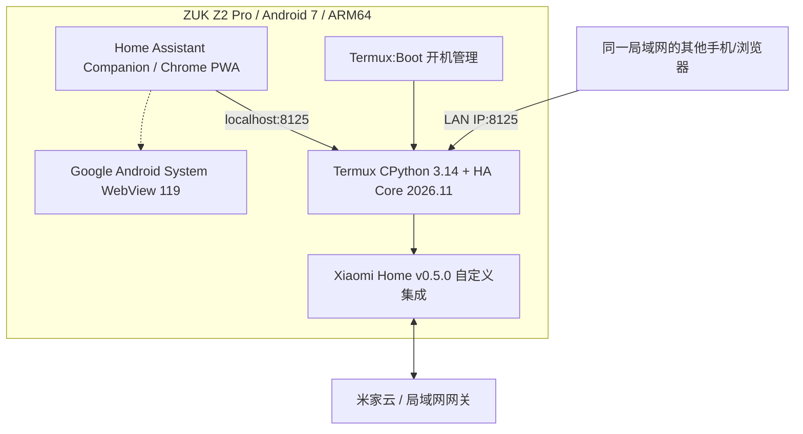

# ZUK Android HA All-in-One | 安卓旧手机端服一体 Home Assistant

> 用一台旧 Android 手机同时运行 **Home Assistant Core 服务端**、**Home Assistant Companion Android 客户端**和**本地触控控制屏**。基于 ZUK Z2 Pro / Android 7 / Termux 的真实工程实践，提供部署 SOP、可复用脚本、WebView 修复与故障排查。

[](docs/00-overview.md) [](docs/01-preflight.md) [](LICENSE)

**状态说明：** 2026-11-12 实机确认：Android 7 上原生 HA Core 2026.11.0 的 HTTP 服务正常，Xiaomi Home 官方自定义集成 v0.5.0 完成配置，Android Companion 2026.11.1 Minimal 安装成功，Google WebView 119 安装成功并由客户端实际加载。**手机端正式账号登录、控制及重启后的长稳验收仍需单独确认。** 请勿将本仓库误认为免编译的一键安装包。

## 架构



**注意：** 如果使用 Chrome 独立打开 HA，它使用 Chrome 浏览器自身的渲染引擎；官方 Companion App 才依赖系统 WebView。

## 实测组合

| 模块 | 版本 / 说明 |
| --- | --- |
| 设备 | ZUK Z2 Pro `Z2121`，代号 `z2_row` |
| Android | 7.0，API 24，ARM64-v8a，原始 Kernel 3.18.31 |
| Python | Termux CPython 3.14.10（需 Android 兼容依赖轮子） |
| Home Assistant Core | `2026.11.0`，原生部署，不依赖 Debian 容器 |
| HA 客户端 | 官方 Android Companion `2026.11.1-minimal` |
| WebView | 从 55.0.2883.91 升级到 Google 签名的 119.0.6045.194 |
| Xiaomi Home | 官方集成 `v0.5.0`，以自定义集成目录部署 |
| 开机启动 | F-Droid 签名的 `Termux:Boot 0.8.1` |
| 服务端端口 | `8125`（自定义，可与其他实例的 `8124` 隔离） |

## SOP 导航

1. [环境检查与无损备份](docs/01-preflight.md)
2. [Termux / Python 3.14 / Android wheel 依赖准备](docs/02-termux-and-wheels.md)
3. [原生 HA Core 安装与服务管理](docs/03-native-ha-core.md)
4. [官方 Xiaomi Home 接入与 OAuth 注意事项](docs/04-xiaomi-home.md)
5. [安卓客户端、WebView 119 与 Chrome PWA](docs/05-android-client-webview.md)
6. [开机自启、控制屏模式与运维](docs/06-kiosk-and-boot.md)
7. [问题定位、回滚与故障恢复](docs/07-troubleshooting.md)
8. [安全、许可及发布前脱敏清单](docs/08-security.md)
9. [实机验收清单](docs/09-validation.md)
10. [依赖源、哈希与 APK 获取说明](assets/checksums/README.md)
11. [ZUK 本地离线中文语音实验 M0](experiments/local-voice/README.md)

**硬核部分：** Android 原生 Python ABI 并非 Linux glibc ABI，Home Assistant 的 C/C++/Rust 原生扩展需要 Android Bionic/NDK 的 wheel 适配；请先看第 2 步。**不建议直接在 Android 7 Termux 执行 `pip install homeassistant` 并期待所有包自动工作。**

## 常用命令

在 **Termux** 中（已按 SOP 准备好环境、且脚本已经复制到 `~/zuk-ha-native/`）：

```bash
bash ~/zuk-ha-native/ha-native-status.sh
bash ~/zuk-ha-native/ha-native-service.sh
bash ~/zuk-ha-native/ha-native-stop.sh
```

在同一手机浏览器或 Companion 中，HA 地址为 `http://127.0.0.1:8125/`；其他同网段设备使用 `http://<ZUK_LAN_IP>:8125/`。本仓库示例中**不包含任何真实家庭 IP、账号、设备 ID 或令牌**。

## 文件说明

```text
.
├── docs/                    # 中文 SOP、架构与排障
├── scripts/on-device/       # 已提取并审核过的 HA 服务管理及验证脚本
├── scripts/mac/             # 便于在 Mac + ADB 上检查版本、服务与 APK 的脚本
├── assets/checksums/        # 官方/第三方二进制来源索引与已核验哈希
├── tests/                   # 公开仓库敏感信息与结构静态检查
├── Makefile                 # 本地校验入口（不需要 GitHub workflow 权限）
├── .gitignore               # 公开仓库的隐私安全边界
└── LICENSE                  # 本仓库原创脚本和文档的许可
```

## 不在仓库里分发的内容

- Home Assistant / Chrome / WebView / Termux 的 **APK 安装包**、第三方依赖 wheel、ROM、系统镜像
- 原始 `config-ha/.storage`、`secrets.yaml`、OAuth token、米家账号、设备密钥和云连接缓存
- 真实日志、设备截图、数据库、局域网地址、ADB 授权信息或临时签名 R2 下载 URL
- 第三方 Xiaomi Home 集成完整源代码（仅提供官方项目链接、版本与安装步骤）

## 风险与责任

Android 7 和 WebView 119 都已停止安全维护。本方案仅建议用于隔离的可信局域网；**不要在公网裸露 8125、不要公开 config 备份**。手机长期开机需关注电池鼓包、充电发热、散热与系统睡眠策略；Root/系统 WebView 更新有兼容风险，提前备份并保留回滚方式。

欢迎提交设备适配的 Issue/PR。本文档记录一台特定手机的实机案例，不代表所有 Android 机型均已测试通过。
