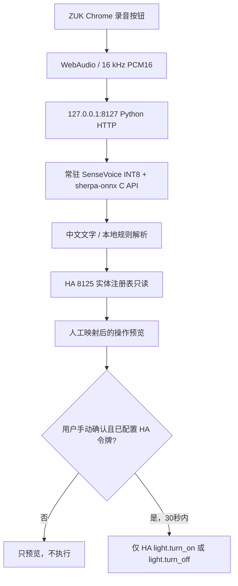

# ZUK Voice Assistant V1.2 — 小米智能家庭面板第二路吸顶灯语音控制

> 用 ZUK Z2 Pro Android 7 作为 HA Core 服务端 + 中文离线语音控制屏。此版本已在 ZUK 实机运行，支持 **先识别和预览 → 人工确认后控制已绑定灯光，或指定小米智能家庭面板的第二路吸顶灯开关**。默认没有 HA 令牌，实际控制保持关闭；**不会语音自动执行**。

## 已验证的真实部署状态（2026-11-13）

- 原生 Home Assistant Core 在 `127.0.0.1:8125`（服务仍 HTTP 200）；老版 Vosk 离线服务在 `127.0.0.1:8126`；**新 SenseVoice INT8 常驻服务在 `127.0.0.1:8127`**。
- Android 7（API 24）+ Termux Python 3.14，调用 NDK 编译的 `libzuk-sensevoice.so` → `libsherpa-onnx-c-api.so` → ONNX Runtime，SenseVoice INT8 模型只初始化一次（实测约 **6.68 秒**，测试启动约 6.84 秒）。
- 同一份之前测试的本地合成语音“打开客厅灯”，通过 `POST /recognize` 返回 **打开客厅灯**、预览 `客厅灯 → turn_on`、`executed:false`。模型预加载后此条识别约 **1.29 秒**。
- `GET /entities` 只读 HA 的实体注册表，允许已启用的普通灯光、窗帘、空调，以及**仅一个**经设备型号、房间、第二路标识、实体名称同时核验的小米智能家庭面板吸顶灯开关；不会向语音端暴露任意插座/墙壁开关。
- 严格监听 `127.0.0.1:8127`，不会通过局域网提供语音接口；POST 同源 Origin 校验、录音大小限制、内容类型限制。错误域实体（如 `lock.*`）的映射请求被拒绝。
- **V1.1** 新增：HA 长期访问令牌本机验证并保存（`0600`）、灯光开关人工确认（30 秒、一次性 nonce）、未映射/无令牌/伪造确认拒绝。已验证无令牌的真实 ZUK 请求被拒绝，未曾主动调用家电控制。
- 不能断言页面**麦克风真人录音**已验收：本次在锁屏时通过 ADB 打开 Chrome，服务已经收到 `/`、`/app.js`、`/health`、`/entities` 请求，但尚未再次完成手动录音验收。

## 端到端结构



## ZUK 上打开测试页面

**只在 ZUK 手机上使用 Chrome 打开**：

```text
http://127.0.0.1:8127/
```

1. 在手机上解锁；Chrome 页面应显示 “SenseVoice INT8 模型常驻”。
2. 点击录音，说“打开客厅灯”，再点击结束；电视背景声下也可测试。
3. 页面显示识别文本、毫秒耗时、动作计划；暂未绑定设备时明确显示“尚未绑定实际设备”。
4. 在页面下方“语音名称”选择“客厅灯”，再在“HA 实体”下拉框中**人工确认具体房间和灯**，点击“保存映射”。私有映射仅写在 ZUK Termux 的 `mapping.private.json`（0600），不写入 HA `.storage`。
5. 再次说指令，页面会显示真实 `entity_id` 与预览动作。**如未配置 HA 令牌，不会真的打开灯**。

### V1.2：面板第二路吸顶灯映射

用户提供的米家截图显示“**小米智能家庭面板 → 按键 → 灯带 / 吸顶灯 / 风扇灯**”。HA 实体注册表确认设备型号 `xiaomi.controller.86v1` 在客厅，面板 10/11/12 服务分别为第 1/2/3 路；其中吸顶灯对应 MIOT `switch` 的 `on_p_11_1`，而不是灯具自身的 `light` 实体。旧映射可能直接控制灯自身，存在墙壁面板断电时命令无效的问题。

- 对语音“打开客厅灯”“关闭客厅灯”“打开客厅吸顶灯”，只允许 **中间吸顶灯这一路** `switch.turn_on / switch.turn_off`。
- **绝不使用 `button.toggle`** 来实现开/关，否则语音“打开”时可能变成关灯。
- 只放行设备型号 `xiaomi.controller.86v1` + MIOT 通道后缀 `_86v1_on_p_11_1` + 设备命名包含“吸顶灯” + HA 区域“客厅”；其他 `switch` 均拒绝。每次实际执行前会再次检查 HA 注册表与私有映射。
- 不改变物理接线，不把面板转成无线模式，不碰第 1 路灯带和第 3 路风扇灯。
- V1.2 映射更新时将旧 `mapping.private.json` 备份在 ZUK 本机，**不上传 GitHub**。更新后需真人录音并点击绿色确认，验证面板和实际灯具都响应。HA 状态页“on/off”只是 HA 报告的开关状态，不能代替真实观察。

### V1.1：人工确认操作灯光（必须由用户在 ZUK 本机完成）

1. 在 ZUK 的 Home Assistant `http://127.0.0.1:8125/profile` 个人资料页面登录，创建 **Long-Lived Access Token（长期访问令牌）**，建议使用单独的非管理员 HA 用户。长期令牌通常继承签发用户的权限，**不等于 HA 原生按实体授权**；本语音服务自身只允许 `light.turn_on` / `light.turn_off`。
2. 在 ZUK `http://127.0.0.1:8127/` 页面“**一次性配置 HA 访问令牌**”输入框粘贴令牌，点击“**验证并在手机本地保存令牌**”；不要把令牌发到 ChatGPT、GitHub、日志或其他手机。服务只向同机 `127.0.0.1:8125/api/` 验证，成功后写入 `~/zuk-ha-voice-v1/ha-token.private`（0600，不上传仓库）。
3. 重新点击“🎙 点击录音”说“打开客厅灯”，结束录音。检查显示的房间、设备以及动作。
4. 在 **30 秒内**点击绿色“**确认打开：客厅灯**”按钮，服务器会重新验证实体映射并一次性执行 HA `light.turn_on`。按钮只对应刚刚这一条语音，不会自动重复。
5. 观察实际灯具是否开启。随后可说“关闭客厅灯”，再次人工确认。**HA HTTP 200 只代表接受请求，仍需观察设备实际状态**。

> 如已在手机页面配置有效 HA 访问令牌，界面可以显示绿色确认按钮，但仍必须由用户亲自点击。无令牌尝试确认返回 `ha_token_not_configured`；无效令牌返回 `HA_token_validation_failed`。

注意：本版要明确房间，“关灯”“关闭窗帘”（不指定房间）会拒绝自动选实体；“打开客厅灯和关闭客厅灯”这样的冲突指令也会拒绝执行。空调温度当前仅为明确的 `16–30℃` 范围内预览。

## 本地源代码结构

- `server.py`：localhost HTTP、离线引擎、只读实体表、手动绑定、指令预览，以及一次性人工确认灯光控制；**源码不包含任何 HA Access Token**。
- `sensevoice_bridge.c`：只提供初始化、PCM16 离线转写和关闭模型的 C API 包装，无网络接口。
- `web/`：在 ZUK Chrome 中运行的按键录音与实体选择页面。
- `start-voice-v1.sh`：Termux 正规应用会话启动脚本（不是 root 启动），重复启动会先探测端口；**本版没有开机自启**。
- `stop-voice-v1.sh`：仅按 `server.py` 精确进程路径结束本版服务，不会误停 HA/Vosk。
- `build-native.sh`：用 Android NDK + 官方 sherpa-onnx v2.0.1 shared Termux C API 构建 Android 7 ARM64 桥接库。
- `tests/test_preview.py`：语义规则单元测试，不需要 HA 或麦克风。
- `tests/test_control_safety.py`：用模拟 HA API 测试令牌保护、单次确认、灯光域限制；**不会真的控制设备**。

## 构建/部署前提

由以下**上游官方**分别获取源码、预编译原生库和模型，不要把它们直接提交到 GitHub：

- [sherpa-onnx v2.0.1 发布页](https://github.com/k2-fsa/sherpa-onnx/releases/tag/v2.0.1)：`sherpa-onnx-v2.0.1-android-aarch64-termux-shared.tar.bz2`。
- [sherpa-onnx 官方 SenseVoice INT8 模型](https://github.com/k2-fsa/sherpa-onnx/releases/download/asr-models/sherpa-onnx-sense-voice-zh-en-ja-ko-yue-int8-2024-07-17.tar.bz2)：需要 `model.int8.onnx` + `tokens.txt`。
- Android NDK r30，本实机使用 `aarch64-linux-android24-clang`；C++ 运行库单独放在实验目录，**不得覆盖系统或原 Termux 运行库**。

在 Mac 构建：

```bash
export ANDROID_NDK_HOME=/path/to/android-ndk-r30
export SHERPA_ONNX_HOME=/path/to/sherpa-onnx-v2.0.1-android-aarch64-termux-shared
bash build-native.sh
python3 tests/test_preview.py
python3 tests/test_control_safety.py
```

部署布局在 ZUK 的 Termux HOME 之下，**要由 Termux 用户拥有，并保留 app SELinux 标签**：

```text
~/zuk-ha-voice-v1/
  server.py
  start-voice-v1.sh
  stop-voice-v1.sh
  web/{index.html,app.js}
  lib/{libzuk-sensevoice.so,libsherpa-onnx-c-api.so,libonnxruntime.so,libc++_shared.so}
  model/{model.int8.onnx,tokens.txt}
  mapping.private.json  # 仅手工映射后创建，禁止上传
  ha-token.private       # 用户在手机 UI 配置后创建，权限 0600，禁止上传
```

在普通 Termux App 环境中运行 `bash ~/zuk-ha-voice-v1/start-voice-v1.sh`。必须保证 `LD_LIBRARY_PATH` **仅包含当前语音 `lib/` 路径**，若混入旧 Termux 库搜索路径，Android 7 会错误解析 `libunwind` 依赖，报 `XzUnpacker_Construct` 符号缺失。使用 `bash ~/zuk-ha-voice-v1/stop-voice-v1.sh` 可停止，勿使用 `killall python`。

## 当前安全边界与下一轮优化

- **V1.2：客厅灯**映射至 HA 中 `xiaomi.controller.86v1` 设备的**第二路（吸顶灯）** `switch` 通道，调用 `switch.turn_on` 或 `switch.turn_off` 而不是 `button.press` 切换键。必须先绑定精确实体、提供有效令牌、明确指令并由用户点击绿色确认；面板灯带/风扇灯、其他插座和任意 `switch` 都不可由语音控制。其余普通灯光继续允许 `light.turn_on/off`。窗帘、空调仍只预览。
- 本机 HTTP 接口使用浏览器 Origin 校验，但对**已安装且恶意构造 HTTP 请求的本机应用不能视为完整身份认证**；因此不要在不可信任的 Android 系统或含未知应用的手机上保存 HA 令牌。Android 7 已停止安全更新，更不应暴露 `8127` 至外部网络。
- HA 长期令牌继承签发用户的权限；本服务通过代码将动作限制为 `light.turn_on` / `light.turn_off` 与人工绑定的实体。手机丢失或泄露时应立即在 HA 个人资料撤销令牌。
- 小米设备的**语音识别链路**是完全本地的，但后续 Home Assistant Xiaomi Home 控制是否经过云端取决于你具体的集成连接模式，**不能据此宣称全流程断网可用**。
- 真机测试 20–40 条真人语音、电视背景声、P50/P95 延迟后，再考虑自动 VAD、离线唤醒词、Termux:Boot 与适当更便捷的授权交互。

**回退：** ZUK 语音目录保留升级前的私有代码备份 `~/zuk-ha-voice-v1/backup-pre-manual-confirm/`，停止脚本仅停止 V1.1，不涉及 HA `8125` 或 Vosk `8126`。

**隐私约束：** 公开仓库只发布原创源码/SOP，第三方权重、厂商 APK、设备清单、HA token、用户语音、私人 HA 注册表和 `mapping.private.json` 均不上传。
