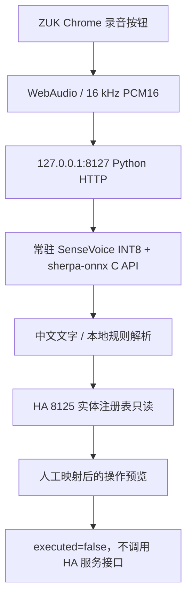

# ZUK Voice Assistant V1 — SenseVoice INT8 本地中控预览

> 用 ZUK Z2 Pro Android 7 作为 HA Core 服务端 + 中文离线语音控制屏。此版本已经在 ZUK 实机运行，**只识别和预览，不执行家电动作**。

## 已验证的真实部署状态（2026-11-13）

- 原生 Home Assistant Core 在 `127.0.0.1:8125`（服务仍 HTTP 200）；老版 Vosk 离线服务在 `127.0.0.1:8126`；**新 SenseVoice INT8 常驻服务在 `127.0.0.1:8127`**。
- Android 7（API 24）+ Termux Python 3.14，调用 NDK 编译的 `libzuk-sensevoice.so` → `libsherpa-onnx-c-api.so` → ONNX Runtime，SenseVoice INT8 模型只初始化一次（实测约 **6.68 秒**，测试启动约 6.84 秒）。
- 同一份之前测试的本地合成语音“打开客厅灯”，通过 `POST /recognize` 返回 **打开客厅灯**、预览 `客厅灯 → turn_on`、`executed:false`。模型预加载后此条识别约 **1.29 秒**。
- `GET /entities` 只读 HA 的实体注册表，本机返回 26 个允许域实体（21 个 light、4 个 cover、1 个 climate），但**没有自动绑定任何实体**；真实设备映射由使用者在 ZUK 页面手工选定。
- 严格监听 `127.0.0.1:8127`，不会通过局域网提供未认证的语音接口；POST 同源 Origin 校验、录音大小限制、内容类型限制。错误域实体（如 `lock.*`）的映射请求被拒绝。
- 不能断言页面**麦克风真人录音**已验收：本次在锁屏时通过 ADB 打开 Chrome，服务已经收到 `/`、`/app.js`、`/health`、`/entities` 请求，但尚未再次完成手动录音验收。

## 端到端结构



## ZUK 上打开测试页面

**只在 ZUK 手机上使用 Chrome 打开**：

```text
http://127.0.0.1:8127/
```

1. 在手机上解锁；Chrome 页面应显示 “SenseVoice INT8 模型常驻”。
2. 点击录音，说“打开客厅灯”，再点击结束；电视背景声下也可测试。
3. 页面显示识别文本、毫秒耗时、动作计划；暂未绑定设备时明确显示“尚未绑定实际设备”。
4. 在页面下方“语音名称”选择“客厅灯”，再在“HA 实体”下拉框中**人工确认具体房间和灯**，点击“保存映射”。私有映射仅写在 ZUK Termux 的 `mapping.private.json`（0600），不写入 HA `.storage`。
5. 再次说指令，页面会显示真实 `entity_id` 与预览动作；**不会真的打开灯**。

注意：本版要明确房间，“关灯”“关闭窗帘”（不指定房间）会拒绝自动选实体；“打开客厅灯和关闭客厅灯”这样的冲突指令也会拒绝执行。空调温度当前仅为明确的 `16–30℃` 范围内预览。

## 本地源代码结构

- `server.py`：localhost HTTP、离线引擎、只读实体表、手动绑定与指令预览；不包含任何 HA Access Token。
- `sensevoice_bridge.c`：只提供初始化、PCM16 离线转写和关闭模型的 C API 包装，无网络接口。
- `web/`：在 ZUK Chrome 中运行的按键录音与实体选择页面。
- `start-voice-v1.sh`：Termux 正规应用会话启动脚本（不是 root 启动），重复启动会先探测端口；**本版没有开机自启**。
- `stop-voice-v1.sh`：仅按 `server.py` 精确进程路径结束本版服务，不会误停 HA/Vosk。
- `build-native.sh`：用 Android NDK + 官方 sherpa-onnx v2.0.1 shared Termux C API 构建 Android 7 ARM64 桥接库。
- `tests/test_preview.py`：语义规则单元测试，不需要 HA 或麦克风。

## 构建/部署前提

由以下**上游官方**分别获取源码、预编译原生库和模型，不要把它们直接提交到 GitHub：

- [sherpa-onnx v2.0.1 发布页](https://github.com/k2-fsa/sherpa-onnx/releases/tag/v2.0.1)：`sherpa-onnx-v2.0.1-android-aarch64-termux-shared.tar.bz2`。
- [sherpa-onnx 官方 SenseVoice INT8 模型](https://github.com/k2-fsa/sherpa-onnx/releases/download/asr-models/sherpa-onnx-sense-voice-zh-en-ja-ko-yue-int8-2024-07-17.tar.bz2)：需要 `model.int8.onnx` + `tokens.txt`。
- Android NDK r30，本实机使用 `aarch64-linux-android24-clang`；C++ 运行库单独放在实验目录，**不得覆盖系统或原 Termux 运行库**。

在 Mac 构建：

```bash
export ANDROID_NDK_HOME=/path/to/android-ndk-r30
export SHERPA_ONNX_HOME=/path/to/sherpa-onnx-v2.0.1-android-aarch64-termux-shared
bash build-native.sh
python3 tests/test_preview.py
```

部署布局在 ZUK 的 Termux HOME 之下，**要由 Termux 用户拥有，并保留 app SELinux 标签**：

```text
~/zuk-ha-voice-v1/
  server.py
  start-voice-v1.sh
  stop-voice-v1.sh
  web/{index.html,app.js}
  lib/{libzuk-sensevoice.so,libsherpa-onnx-c-api.so,libonnxruntime.so,libc++_shared.so}
  model/{model.int8.onnx,tokens.txt}
  mapping.private.json  # 仅手工映射后创建，禁止上传
```

在普通 Termux App 环境中运行 `bash ~/zuk-ha-voice-v1/start-voice-v1.sh`。必须保证 `LD_LIBRARY_PATH` **仅包含当前语音 `lib/` 路径**，若混入旧 Termux 库搜索路径，Android 7 会错误解析 `libunwind` 依赖，报 `XzUnpacker_Construct` 符号缺失。使用 `bash ~/zuk-ha-voice-v1/stop-voice-v1.sh` 可停止，勿使用 `killall python`。

## 下一阶段：安全的实际 HA 控制

1. 在手机页面绑定准确的 `light`/`cover`/`climate` 实体；确认房间与设备。
2. 连续采集 20–40 条真人短指令，在电视背景声下比较准确率、P50/P95 延迟；重点防止把“卧室”误判为“客厅”。
3. **只有在完成映射与验证后**，增加经过授权的最小权限 HA token，先开放普通灯具的明确开关；空调、窗帘逐项验收。
4. 避免解锁门锁、燃气等高风险实体，误识别或者目标不明确时拒绝操作。
5. 通过真机稳定性测试后再讨论 Termux:Boot 开机自启、悬浮语音按钮、Silero VAD 自动截断与离线唤醒词。

**隐私约束：** 本仓库只发布原创源码/SOP，第三方权重、厂商 APK、设备清单、HA token、用户语音、私人 HA 注册表和 `mapping.private.json` 均不上传。
